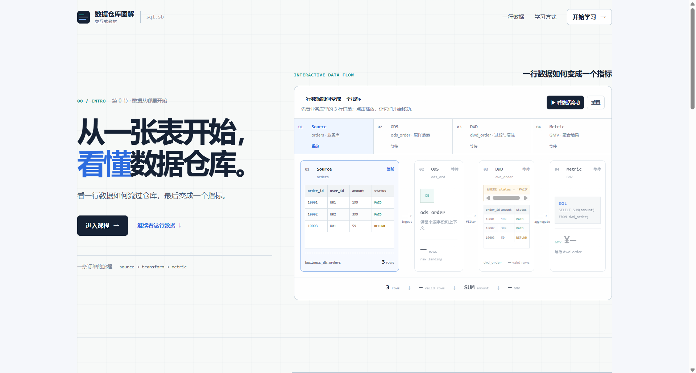
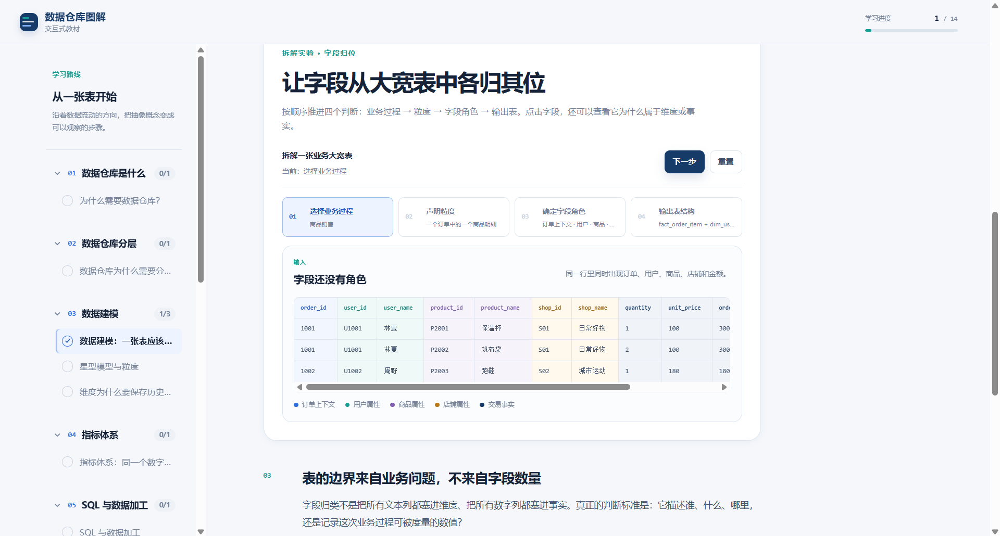
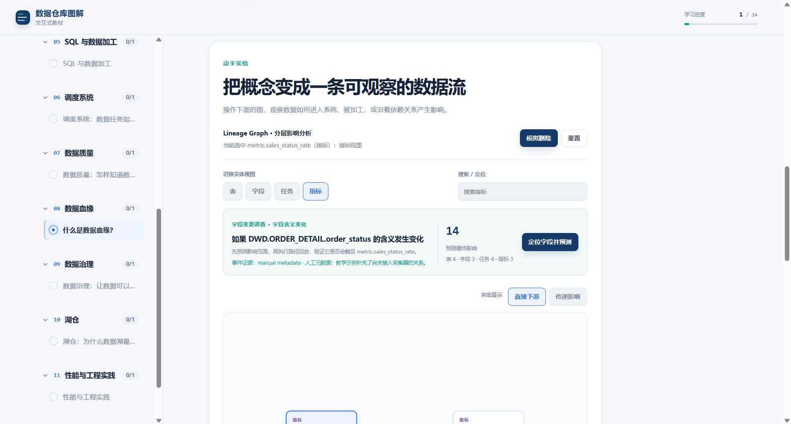

<div align="center">

# SQL.SB — Interactive Data Warehouse Learning

**Learn data warehouse engineering by following the data—from SQL rows and dimensional models to ETL pipelines, lineage, and lakehouse table state.**

[Explore English resources](https://sql.sb/en/) · [Enter the Chinese learning space](https://sql.sb/)

README: [English](README.md) · [简体中文](README.zh-CN.md)

</div>

---



SQL.SB teaches data warehouse concepts through concrete datasets, SQL, visual models, and interactive exercises. Follow how data moves from source systems through modeling and transformation to reporting and downstream services—and inspect what changes when assumptions, rows, or pipeline state change.

The Chinese learning space contains **64 lessons**. The English section is a curated set of English-language resources, **not** a 64-lesson translation of the Chinese course. Start with the [English resource hub](https://sql.sb/en/) or browse the [Chinese learning space](https://sql.sb/).

## What you can explore

- **SQL and query behavior:** inspect join fan-out, duplicated rows, and the effect of grain on aggregates.
- **Dimensional modeling:** work through fact and dimension tables, star and snowflake schemas, and the meaning of one row.
- **SCD Type 2:** follow effective-date history and query historical dimension versions with SQL.
- **ETL and pipeline operations:** compare ETL with ELT, incremental with full loads, and reason about idempotent reruns, recovery, data quality, and observability.
- **Data lineage:** trace downstream impact and distinguish data lineage from scheduler task dependencies.
- **Lakehouse architecture:** see how data files, table formats, catalogs, and query engines fit together.

These are teaching examples, not claims that every production platform uses the same design. The site uses banking scenarios alongside general data-engineering examples; its fixtures are intended to make the underlying concepts inspectable.

## Selected English resources

The English pages are independently written, focused resources. Some include interactive examples; they do not mirror every lesson in the Chinese learning space.

### SQL

- [SQL resources](https://sql.sb/en/sql/)
- [Why does a SQL JOIN duplicate rows?](https://sql.sb/en/sql/sql-join-duplicate-rows/)
- [SQL data skew](https://sql.sb/en/sql/data-skew/)
- [Partition pruning in SQL](https://sql.sb/en/sql/partition-pruning/)

### Data warehousing

- [Data warehouse engineering](https://sql.sb/en/data-warehouse/)
- [Data warehouse grain](https://sql.sb/en/data-warehouse/grain/)
- [Fact vs. dimension tables](https://sql.sb/en/data-warehouse/fact-vs-dimension-tables/)
- [SCD Type 2](https://sql.sb/en/data-warehouse/scd-type-2/)
- [Data lineage vs. task dependency](https://sql.sb/en/data-warehouse/data-lineage-vs-task-dependency/)
- [ETL vs. ELT](https://sql.sb/en/data-warehouse/etl-vs-elt/)
- [Idempotent ETL](https://sql.sb/en/data-warehouse/idempotent-etl/)
- [Pipeline failure recovery](https://sql.sb/en/data-warehouse/pipeline-failure-recovery/)
- [What is a lakehouse?](https://sql.sb/en/data-warehouse/lakehouse/)

## Screenshots

These screenshots show representative interfaces from the interactive learning space.

### Dimensional modeling



### Data lineage and impact analysis



## Run locally

The project is a static site. You do not need to install a database or a data-processing cluster to run it locally. Use Node.js `>= 22.12`:

```bash
git clone https://github.com/0verme/data-warehouse-visualized.git
cd data-warehouse-visualized
npm install
npm run dev
```

Open <http://localhost:4321>.

<details>
<summary><b>Useful commands and project structure</b></summary>

```bash
npm run test         # Run Vitest unit tests
npm run check        # Run Astro and TypeScript checks
npm run lint         # Run ESLint
npm run format:check # Check formatting with Prettier
npm run build        # Build the static site into dist/
npm run preview      # Preview the production build locally
```

The release checks also include a Chromium browser smoke test. Install Chromium first:

```bash
npx playwright install chromium
npm run test:e2e:smoke # Build, preview, and check desktop and mobile layouts
```

```text
src/
├── components/       # Course shell, lesson UI, and visualizations
├── content/          # Lesson text and example data
├── data/             # Lesson schemas, metadata, and course structure
├── i18n/             # Locale definitions and shared UI copy
├── layouts/          # Astro layouts and SEO configuration
├── pages/            # Home, learning, and English resource routes
├── styles/           # Global styles and responsive rules
├── types.ts          # Shared visualization types
└── utils/            # Navigation, progress, lineage, and scheduling logic
docs/
├── images/           # README and documentation screenshots
└── DEPLOYMENT.md     # Production build and deployment guide
```

For production builds and deployment, see the [deployment guide](docs/DEPLOYMENT.md) (currently in Chinese).

</details>

## Contributing

Contributions are welcome, including technical corrections, new teaching examples, interactive exercises, accessibility improvements, and bug fixes.

- Open an [issue](https://github.com/0verme/data-warehouse-visualized/issues) to discuss a scenario or propose a change.
- Read the [contribution guide](CONTRIBUTING.md) before submitting code or course changes. The guide and deeper project documentation are currently in Chinese.

## Licenses

This repository uses separate licenses for software and course materials:

- **Source code** — [Apache License 2.0](LICENSE).
- **Original course text, teaching diagrams, and examples** — [CC BY-NC-SA 4.0](CONTENT_LICENSE.md). This license requires attribution and sharing adaptations under the same license, and **does not permit commercial use**. Contact the project author for separate commercial permission.

The project name, `sql.sb` brand, logos, third-party dependencies, and other separately licensed materials are not automatically covered by the course-content license. See [CONTENT_LICENSE.md](CONTENT_LICENSE.md) for its scope.
